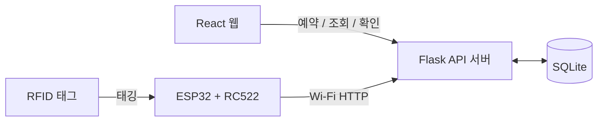

# Rental Management

RFID 태그와 ESP32로 공용 물품의 예약·대여·반납을 관리하는 웹 서비스입니다.

> TODO: 프로젝트 정식 이름이 정해지면 제목을 바꿔 주세요.

## 소개

학교 동아리·실습실에서 공구, 스포츠용품, 실습 장비를 빌려줄 때 수기 장부나 구두 확인에 의존하면 대여 현황을 파악하기 어렵고 분실·연체 관리가 비효율적입니다.
이 서비스는 웹 기반 예약·대여 관리와 RFID 태깅 기록을 결합해, 예약부터 대여·반납까지 전 과정을 자동으로 관리합니다.

## 주요 기능

- **사용자**: 회원가입/로그인, 물품 검색·예약·취소, 내 대여 내역과 반납 기한 확인, 연체·예약 취소 알림
- **관리자**: 물품 등록·수정·삭제(RFID 태그 지정), 재고·대여·연체 대시보드, 연체자 목록
- **하드웨어**: 물품에 붙은 RFID 태그를 ESP32 리더기에 태깅해 대여·반납 처리

## 동작 흐름



1. 사용자가 웹에서 물품을 예약합니다.
2. 물품을 받을 때 웹에서 **수령하기**를 누르고 RFID 태그를 ESP32에 태깅합니다.
3. ESP32가 태그 값을 `POST /api/device/tag`로 보냅니다. 대여와 반납을 구분하지 않고, 서버가 물품 상태를 보고 판단합니다.
   - 물품이 `rented`면 반납 처리
   - 물품이 `reserved`이고 수령하기가 눌려 있으면 본인 확인 대기로 전환
   - 둘 다 아니면 에러
4. 웹에 "본인이 맞습니까?"가 표시되고, **예**를 누르면 대여가 시작됩니다. 아니오를 누르면 취소됩니다.
5. 반납 기한이 지나면 연체로 표시하고 사용자와 관리자에게 알립니다. 픽업 기한을 넘긴 예약은 자동 취소됩니다.

## 기술 스택

| 구분 | 기술 | 용도 |
|---|---|---|
| Frontend | React.js | 물품 목록·검색, 예약 UI, 관리자 대시보드 |
| Backend | Python, Flask, Flask-Login, APScheduler | REST API, 세션 인증, 연체·자동취소 스케줄러 |
| Database | SQLite, SQLAlchemy | 회원, 물품, 예약, 대여, 알림 저장 |
| Hardware | ESP32, RC522 RFID 모듈 | 태그 스캔 및 서버 전송 |
| 협업 | GitHub, Notion, Postman, Figma | 버전 관리, 일정, API 테스트, UI 설계 |

## 폴더 구조

| 폴더 | 내용 |
|---|---|
| [`frontend/`](frontend/) | React 웹 |
| [`backend/`](backend/) | Flask API 서버 |
| [`db-package/`](db-package/) | DB 모델, 스키마, 시드 데이터, 설계 문서 |
| [`hardware/`](hardware/) | ESP32 펌웨어 |

## 시작하기

> 현재 백엔드는 API 구조(URL, 권한)만 구현된 단계이며, 구현되지 않은 엔드포인트는 `501`을 반환합니다.

### Backend

```bash
cd backend
python -m venv venv
venv\Scripts\activate          # macOS/Linux: source venv/bin/activate
pip install -r requirements.txt
copy ..\.env.example ..\.env   # macOS/Linux: cp ../.env.example ../.env  (값을 채워 주세요)
python app.py
```

환경 변수는 [`.env.example`](.env.example)을 참고하세요. `.env`는 Git에 올라가지 않습니다.

### Frontend

> TODO: 프론트엔드 실행 방법

### Hardware

> TODO: 펌웨어 업로드 방법과 서버 주소, `X-Device-Key` 설정 방법

## API

모든 API는 `/api` 아래에 있습니다. 인증은 세션 쿠키, ESP32는 `X-Device-Key` 헤더를 사용합니다.

| 구역 | 엔드포인트 | 권한 |
|---|---|---|
| 인증 | `POST /auth/register`, `POST /auth/login`, `POST /auth/logout`, `GET /auth/me` | 가입·로그인은 누구나 |
| 물품 | `GET /items`, `GET /items/{id}`, `POST /items`, `PUT /items/{id}`, `DELETE /items/{id}` | 조회는 로그인, 변경은 관리자 |
| 예약·대여 | `POST /reservations`, `GET /reservations/me`, `POST /reservations/{id}/cancel`, `POST /reservations/{id}/pickup-request`, `GET /me/pending-confirm`, `POST /reservations/{id}/confirm` | 로그인, 취소·수령·확인은 본인 |
| ESP32 | `POST /device/tag` | `X-Device-Key` |
| 알림·관리자 | `GET /notifications/me`, `PATCH /notifications/{id}/read`, `GET /admin/dashboard`, `GET /admin/reservations`, `GET /admin/overdue` | 알림은 로그인·본인, 관리자는 관리자 |

## 데이터베이스

테이블 7개(`users`, `items`, `reservations`, `pending_confirmations`, `rentals`, `overdue_notifications`, `notifications`)를 3NF로 설계했습니다.
스키마와 상태값은 [`db-package/DB_README.md`](db-package/DB_README.md), 설계 근거는 [`db-package/DB_NORMALIZATION.md`](db-package/DB_NORMALIZATION.md)를 보세요.

## 팀

| 이름 | 역할 | 담당 |
|---|---|---|
| 양나은 | Frontend Lead | React UI/UX, 반응형 웹 |
| 남희성 | Backend Engineer | Flask 서버 로직, 스케줄러 |
| 황상건 | Database Architect | SQLite 모델링, 쿼리 최적화 |
| 황상건 | Hardware/IoT Specialist | ESP32 펌웨어, RC522 연동 |

## 협업 규칙

- `main`에는 직접 푸시하지 않고 Pull Request로만 합칩니다.
- 작업(이슈) 하나마다 브랜치 하나를 만듭니다. 예: `feature/api-auth`, `fix/rent-schema`, `docs/readme`
- 이슈에는 `frontend`, `backend`, `database`, `hardware` 라벨을 붙입니다.
- `.env`와 비밀키는 커밋하지 않습니다.
